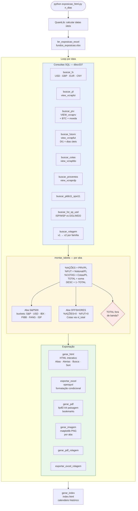

# exposicao_html.py — Visão Geral

**Arquivo:** `src/exposicao_html.py`
**Propósito:** Gera o Relatório de Exposição diário dos fundos da Itaú Asset — PNG, Excel, HTML interativo, PDF e índice histórico.

---

## Fluxo principal (`main`)

```
python exposicao_html.py [n_dias]
```

1. Calcula as datas úteis (QuantLib Brasil) retroativas a partir de hoje
2. Lê o Excel de configuração (`../input/fundos_exposicao.xlsx`)
3. Para cada data:
   - Consulta SQL: FX → PL → PRV → Futuros → Cotas → Proventos → PIBB/SPXI → Fut S&P/USD → Rolagem
   - Monta tabelas por aba
   - Exporta: Excel → HTML → PDF → PDF Rolagem → Excel Rolagem
4. Gera o `index.html` com calendário histórico

---

## Diagrama de fluxo



---

## Arquivos de entrada

| Variável | Caminho padrão | Descrição |
|---|---|---|
| `INPUT_EXCEL` | `../input/fundos_exposicao.xlsx` | Configuração de fundos por aba (FUNDO, BENCH, MAX, MIN) |
| `INPUT_FUNDOS_ROL` | `../input/fundos.txt` | Lista de fundos incluídos no relatório de rolagem |
| `LOGO_PATH` | `../input/logo.png` | Logo para cabeçalho nos relatórios |

---

## Abas processadas (`SHEETS`)

```
SINGLES, IBOV, ETFs, S&P500, OFFSHORES, MOEDAS,
RENDA FIXA, OURO e TREASURY, DEBENTURES, ACWI, CDI
```

Cada aba do Excel deve ter colunas: `FUNDO`, `BENCH`, `MAX`, `MIN`.
A leitura é tolerante a variações de capitalização e nomes próximos.

---

## Saídas por data (`../output/relatorios/YYYYMMDD/`)

| Arquivo | Função |
|---|---|
| `exposicao_{aba}_{dt}.png` | Imagem matplotlib por aba |
| `exposicao_{dt}.xlsx` | Excel com formatação condicional |
| `exposicao_{dt}.html` | HTML interativo com abas, busca e alertas |
| `exposicao_{dt}.pdf` | PDF A4 paisagem navegável (fpdf2) |
| `rolagem_{dt}.pdf` | PDF separado de rolagem de futuros |
| `rolagem_{dt}.xlsx` | Excel de rolagem |

Índice histórico: `../output/relatorios/index.html`

---

## Paleta de cores Itaú

```python
ITAU_DARK   = "#000D3C"   # azul escuro — fundo de cabeçalhos
ITAU_ORANGE = "#EC7000"   # laranja — destaques, TOTAL na faixa
ITAU_RED    = "#c0392b"   # vermelho — fora de banda
ITAU_GREEN  = "#1e7e34"   # verde — TOTAL ≥ 99%
ROW_PAR     = "#eaf0fb"   # azul claro — linhas pares
```

---

## Dependências

```python
pandas, numpy, QuantLib, matplotlib, openpyxl, fpdf2
sql_connection  # módulo interno de conexão com dbsx337
```

---

## Links relacionados

- [[exposicao_dados]] — consultas SQL
- [[exposicao_calculos]] — cálculo de exposição
- [[exposicao_outputs]] — geração de relatórios
- [[exposicao_rolagem]] — rolagem e Beta
