# Taxa média de aquisição dos papéis de crédito atrelados ao CDI

Documentação do `taxa_media/__main__.py`: o que o script calcula, de onde vêm os dados, as regras de cada passo e como ler o resultado.

```
taxa_media/
├── __main__.py           script
├── html_report.py        relatório HTML (mesmo layout do attribution)
├── sql_connection.py     conexão com o DBSX337
├── input/fundos.xlsx     fundos, tipos de papel e correções manuais
├── sql/taxa_media.sql    o mesmo cálculo em T-SQL, para um fundo no SSMS
├── output/               Excel e relatório HTML gerados
│   ├── index.html        com --diario: calendário com todos os dias
│   └── diario/           com --diario: um relatório por dia (aaaammdd.html)
└── doc/
    ├── taxa_media.md     esta documentação
    └── fluxograma.mmd    relações do código (Mermaid)
```

## 1. O que o script calcula

Para cada fundo da lista em `input/fundos.xlsx`, o script calcula a **taxa de aquisição** dos papéis de crédito atrelados ao CDI (CRI, debênture, CRA etc.): a taxa negociada na compra de cada lote, e não a taxa de mercado (MTM). O resultado sai em quatro níveis:

| Nível | Como é calculado |
|---|---|
| Lote | taxa da compra: a da boleta do front ou a da custódia (VCRA) |
| Ativo | média das taxas dos lotes em aberto, ponderada pela quantidade em aberto |
| Grupo (CDI+ e %CDI) | média dos ativos, ponderada pelo financeiro atual, na unidade do grupo |
| Carteira | média de todos os ativos, ponderada pelo financeiro atual, em CDI+ equivalente |

Entram só os tipos de papel marcados na aba Tipos e só papéis atrelados ao CDI. IPCA+, pré e SELIC ficam fora, com aviso.

Com `--desde`, o mesmo cálculo é refeito em cada data desde o início do fundo, ou desde uma data, e a evolução da carteira sai na aba Histórico (seção 6.14).

Além da carteira, o script mostra os trades: cada compra e venda, com a taxa pelas mesmas regras dos lotes, e a taxa média dos trades de cada dia, por fundo (seção 6.15).

Junto com o Excel sai um relatório HTML com as mesmas tabelas, gráficos e a ficha de cada ativo (seção 2, Relatório HTML).

Com `--diario`, sai também um relatório por dia na pasta `output/diario/` e o `output/index.html`, com um calendário para escolher o dia (seção 2, Relatórios diários e calendário).

## 2. Como rodar

O script precisa rodar numa máquina com acesso ao DBSX337 (servidor SQNPRC028). A conexão é a do `sql_connection.py` da pasta e exige:

- o ODBC Driver 18 for SQL Server;
- as variáveis de ambiente `SQL_LOGIN` e `SQL_PASSWORD`;
- os pacotes `pandas`, `openpyxl`, `pyodbc` e `sqlalchemy`.

Rode de dentro de `taxa_media/`, ou com `python taxa_media` a partir de `itau_asset/`:

```
python __main__.py                          (fundos da aba Fundos, cada um na última data da posição)
python __main__.py --data 23/10/2026
python __main__.py --fundo ITAIMOBCDIFII    (só esse fundo; tipos e correções continuam vindo do Excel)
python __main__.py --fonte vcra --cdi 13.65
python __main__.py --fundo ITAIMOBCDIFII --desde            (série mensal desde o início do fundo)
python __main__.py --desde 01/06/2026 --frequencia diaria   (série diária a partir de 01/06/2026)
python __main__.py --html output/taxa_media_historico_ITAIMOBCDIFII_20261023.xlsx   (só o relatório HTML)
python __main__.py --fundo ITAIMOBCDIFII --desde --diario   (um relatório por dia desde o início e o index.html)
python __main__.py --diario                                 (a última data, somada aos dias que já estão na pasta)
```

| Parâmetro | Padrão | O que faz |
|---|---|---|
| `--entrada` | `input/fundos.xlsx` | Excel com as abas Fundos, Tipos e Correções (seção 3) |
| `--fundo` | fundos da aba Fundos | um ou mais fundos no lugar da aba Fundos; só letras, números e `_` |
| `--data` | última data de cada fundo na `VW_FUNDOS_POSICAO` | data de referência, dd/mm/aaaa, a mesma para todos os fundos; com `--desde`, é o fim da série |
| `--desde` | sem série | refaz o cálculo em cada data desde dd/mm/aaaa. Sozinho (ou com `inicio`), começa na primeira data do fundo na `VW_FUNDOS_POSICAO`. Grava a aba Histórico (seção 6.14) |
| `--frequencia` | `mensal` | datas da série: `mensal` (a última data com posição de cada mês) ou `diaria` (todas as datas com posição). Só vale com `--desde` |
| `--fonte` | `lake` | taxa dos CDI+: `lake` (a boleta do Lake, negociada) ou `vcra` (custódia, calculada pelo PU pago). Os %CDI usam sempre o Lake. `boleta`, o nome antigo, vale como `lake` |
| `--cdi` | `CDIAcumulado` da `FUNDOS_DADOS_INDICES` na data de cada fundo | CDI em % a.a., usado só para converter %CDI em CDI+ equivalente |
| `--html` | — | só regera o relatório HTML de um `.xlsx` já gravado, sem o banco e sem o Excel de entrada; o `.html` sai ao lado do `.xlsx`. Serve para gerar o relatório numa máquina sem acesso ao DBSX337 |
| `--diario` | — | grava também um relatório por data em `output/diario/aaaammdd.html` e refaz o `output/index.html`. Com `--desde`, a série passa a ser diária (salvo `--frequencia mensal`) |

Sem o Excel, o script só roda com `--fundo`; nesse caso usa os tipos padrão (seção 3) e nenhuma correção.

### Saída

Cada rodada grava um Excel em `output/` e, ao lado, o relatório HTML com o mesmo nome (abaixo). O nome é `taxa_media_<aaaammdd>.xlsx`, ou `taxa_media_<fundo>_<aaaammdd>.xlsx` quando roda um fundo só. Com `--desde`, o nome começa com `taxa_media_historico`. A data é a do `--data` ou a mais recente entre os fundos. Todas as abas têm a coluna Fundo:

| Aba | Conteúdo |
|---|---|
| Histórico | só com `--desde`: uma linha por fundo e data da série, com taxa e financeiro da carteira e de cada grupo, quantidade de ativos e de lotes, CDI do dia e avisos por tipo. As abas Carteira, Ativos, Lotes e Avisos são da última data |
| Carteira | por fundo, uma linha por grupo e a linha CARTEIRA, com notas sobre as convenções |
| Ativos | por ativo: tipo, taxa média, conferência de quantidade, PU, financeiro e CDI+ equivalente |
| Lotes | por lote em aberto: tipo, indexador, compra, boleta casada, taxa da VCRA, taxa usada e de onde ela veio |
| Trades por dia | uma linha por dia e operação (compra ou venda): trades, ativos, financeiro e taxa média por grupo e em CDI+ equivalente; os trades sem taxa à parte. Cobre todo o histórico até a data ou, com `--desde`, a partir do início da série |
| Trades | cada compra e venda da VCRA no escopo: ativo, lote, quantidade, PU, financeiro, boleta casada, taxa da VCRA, taxa usada e de onde ela veio |
| Avisos | tudo o que merece conferência (seção 8) |
| Cadastro | as versões de cada campo do `FUNDOS_CADASTRO_ATIVOS` dos ativos, até a data: ativo, campo, valor, desde quando e fonte. É o que o HTML mostra na ficha do ativo (e o que o `--html` relê); não tem a coluna Fundo, porque o cadastro é do ativo |
| Fundos | uma linha por fundo: data, status, taxa da carteira, financeiro, contagens e CDI usado |
| Parâmetros | entrada, fonte, tipos incluídos e excluídos, regras de casamento e correções aplicadas |

No console sai um bloco por fundo, com os avisos, o resultado de cada grupo e uma linha com os trades do período, e no fim um resumo com uma linha por fundo. Com `--desde`, o bloco começa com uma linha por data da série.

Um erro num fundo (sem posição na data, consulta vazia) não para os outros: o fundo aparece na aba Fundos com o erro, e o script termina com código de saída 1.

### Relatório HTML

Ao lado do Excel sai um `.html` com o mesmo nome, gerado pelo `html_report.py` no layout do relatório do attribution: cabeçalho Itaú, abas no topo, tabelas que ordenam no clique e gráficos com tooltip. É um arquivo só, sem dependências: abre em qualquer navegador e pode ser mandado por e-mail. O relatório usa as mesmas tabelas do Excel, por isso o `--html` regera exatamente o mesmo relatório a partir de um `.xlsx` gravado.

| Aba | O que mostra |
|---|---|
| FUNDOS | só com mais de um fundo: a taxa da carteira de cada fundo em barras e a tabela da aba Fundos. Clicar num fundo abre o resumo dele |
| RESUMO | cartões com a taxa da carteira (com a evolução, se houver série), %CDI, CDI+, financeiro e avisos. Abaixo, a composição do financeiro por grupo e a cascata de contribuição de cada ativo para a taxa da carteira, com o valor em cada barra; clicar na barra ou no código do ativo, no eixo, abre a ficha dele com o cadastro, e Demais abre a aba ATIVOS. Depois, a tabela por grupo e os cartões de compras e vendas do período |
| HISTÓRICO | só com `--desde`: taxa da carteira e spread dos CDI+ num painel, taxa dos %CDI em outro e financeiro por grupo num terceiro, todos no mesmo eixo de datas. Um resumo do período e a tabela, uma linha por data. Um dia fora da curva (o começo do fundo, com um ou dois ativos) não achata o gráfico: a escala ignora os extremos (percentis 3% e 97%), a linha é cortada na borda e o painel avisa quantos valores ficaram fora |
| ATIVOS | taxa de cada ativo em CDI+ equivalente (barras, com a linha da carteira) e o peso dele no financeiro. Na tabela, também a contribuição de cada ativo: peso × taxa em CDI+ equivalente. A soma das contribuições é a taxa da carteira |
| LOTES | quantos lotes têm a taxa da boleta, da VCRA, manual ou nenhuma, e a dispersão boleta × VCRA de cada grupo. Na diagonal as duas taxas são iguais; os lotes com aviso Boleta × VCRA saem em vermelho, com o código. Depois, a tabela de lotes em aberto |
| TRADES | cartões de compras e vendas, o gráfico da taxa média de cada dia (com a taxa da carteira como referência, se houver série) e do financeiro do dia, a tabela Trades por dia e a tabela de cada trade |
| AVISOS | um cartão por tipo de aviso, com o que ele quer dizer, e a tabela de avisos |
| METODOLOGIA | como navegar, glossário, a aba Parâmetros e as notas |

Para navegar:

- O seletor FUNDO, no começo da barra de abas (à esquerda), lista os fundos da rodada, com o nome da aba Fundos, e troca o fundo em todas as abas. Para ter vários fundos no relatório, basta pôr os fundos na aba Fundos do `input/fundos.xlsx` (rodar = S) e rodar sem `--fundo`.
- Cada tabela tem busca por texto, sem acento nem caixa, e seletores (grupo, fonte da taxa, operação, tipo de aviso). O contador mostra quantas linhas sobraram.
- Clicar num ativo, numa tabela ou num gráfico, abre a ficha dele: o nome e a descrição do papel, cartões com taxa, financeiro, peso e quantidades, o cadastro e os lotes, trades e avisos do ativo. O cadastro vem em três quadros (emissão; crédito e risco; identificação), com as alterações de valor (ex.: troca do emissor) e, num bloco que abre no clique, todos os campos, com a data de cada valor e a fonte. A aba ATIVOS também ganha as colunas Grupo econômico e Rating, e a busca da tabela acha os ativos por elas.
- Na aba TRADES, clicar num dia, no gráfico ou na tabela Trades por dia, filtra a tabela de trades. O botão do dia limpa o filtro.
- Os cartões com contagem (fonte da taxa, tipo de aviso, compras, vendas) também filtram a tabela da aba.
- Nos gráficos de série, o tooltip mostra todas as séries na data mais próxima do mouse, e as caixas da legenda escondem uma linha.

As cores seguem a entidade em todo o relatório: carteira laranja, CDI+ azul e %CDI roxo, o mesmo trio do attribution. Compras ficam em verde-azulado e vendas em framboesa. As duas combinações (carteira, CDI+ e %CDI; carteira, compras e vendas) passam no teste de separação para daltonismo.

### Relatórios diários e calendário (`--diario`)

Com `--diario`, cada data calculada vira um relatório próprio, e o `index.html` junta todos:

```
output/
├── index.html          calendário com todos os dias da pasta e as abas consolidadas
└── diario/
    ├── 20260401.html   relatório do dia 01/04/2026
    ├── 20260402.html
    └── ...
```

O relatório de cada dia tem o mesmo layout do relatório normal, com as abas RESUMO, ATIVOS, LOTES, TRADES, AVISOS e METODOLOGIA, e FUNDOS quando há mais de um fundo. Mostra a carteira, os ativos, os lotes e os avisos daquela data, calculados só com o que existia nela, como na série do `--desde`. Os trades são os executados desde a data anterior da série até a data: numa série diária, os do dia; numa mensal, os do mês. Assim cada trade aparece em um relatório só. O arquivo abre sozinho no navegador e tem um botão CALENDÁRIO que volta para o `index.html`.

O `index.html` tem três abas:

| Aba | O que mostra |
|---|---|
| CALENDÁRIO | à esquerda, o calendário do mês: cada dia com relatório mostra embaixo a taxa da carteira em CDI+ equivalente, e um ponto verde quando teve trade. Abaixo, os botões de dia anterior e próximo e o quadro do dia escolhido (carteira, grupos, financeiro, ativos e lotes, avisos, CDI, compras e vendas). À direita, o relatório do dia |
| HISTÓRICO | a série de todos os dias da pasta (o mesmo gráfico e a mesma tabela da aba HISTÓRICO do relatório). Clicar numa data, no gráfico ou na tabela, abre o dia no calendário |
| TRADES | compras e vendas de todos os dias, com o gráfico da taxa média do dia e a tabela Trades por dia. Clicar num dia abre o relatório dele na aba TRADES |

Para navegar no calendário:

- Clique num dia ou use as setas ← e → do teclado. O seletor de mês e os botões ‹ › trocam o mês.
- A aba aberta no relatório continua aberta quando você troca de dia. Dá para ver os ATIVOS de um dia e passar para o seguinte direto nos ATIVOS.
- O seletor FUNDO do índice lista os fundos que têm relatório diário e vale para o calendário, o quadro do dia, as abas consolidadas e o relatório aberto.
- "Abrir este dia em nova aba" abre o arquivo do dia sozinho.

O índice é refeito do zero a cada rodada com `--diario`, a partir de todos os arquivos `aaaammdd.html` da pasta. Por isso, rodar todo dia com `--diario`, sem `--desde`, soma o novo dia aos que já estão lá. Um dia rodado de novo é regravado, com os fundos da última rodada. Cada relatório diário guarda um resumo (JSON no `<head>`) que o índice lê, e assim o índice não depende de outro arquivo. Arquivos da pasta que não são relatórios ficam de fora.

O navegador abre tudo direto do disco, sem servidor: o relatório do dia aparece dentro do índice num iframe, e os dois conversam por `postMessage`. Cada relatório diário tem cerca de 250 kB; uma série diária de 148 dias com dois fundos ocupa cerca de 35 MB.

### Versão em SQL

`sql/taxa_media.sql` faz o mesmo cálculo para um fundo numa data, direto no SSMS; a série do `--desde` existe só no script. As variáveis `@tipos` e `@correcoes` fazem o papel das abas Tipos e Correções e precisam ser preenchidas à mão. A query devolve seis resultados: Parâmetros, Carteira, Ativos, Lotes, Avisos e Pendências. As Pendências saem no formato da aba Correções (fundo, CD, taxa, aplicar, motivo): é preencher a taxa, trocar `aplicar` para S e colar as linhas na aba.

## 3. Entrada: `input/fundos.xlsx`

As colunas S/N aceitam S, Sim, X ou 1; qualquer outra coisa vale N. Os nomes das abas e das colunas não diferenciam maiúsculas nem acento. A aba Leia-me resume estas regras.

**Fundos**: um fundo por linha.

| Coluna | Conteúdo |
|---|---|
| `fundo` | código do fundo (`codigo_IAM_fundo` = `CLCLI_CD` da VCRA) |
| `rodar` | S/N; vazio = S |
| `nome` | livre, só para o relatório |

**Tipos**: os `RFTP_CD` da VCRAOPRF e se cada um entra no cálculo.

| Coluna | Conteúdo |
|---|---|
| `RFTP_CD` | tipo do papel na VCRA (ex.: `CRI-I`) |
| `incluir` | S/N |
| `descricao` | livre |

Um tipo que aparece na VCRA do fundo e não está na aba sai com o aviso "Tipo novo" e fica fora até ser classificado. As compromissadas ficam com N: `LTN-O`, `NTN-O` e `LFT O` são over do caixa; `CRIOP` e `CRILA` usam o código do CRI de lastro (seção 10). Sem a aba Tipos, valem os tipos padrão do script: `CRI-I` incluído e as cinco compromissadas excluídas.

**Correções**: taxa corrigida à mão de um lote.

| Coluna | Conteúdo |
|---|---|
| `fundo` | fundo do lote |
| `CD` | código do lote na VCRA |
| `taxa` | na convenção do grupo do ativo: CDI+ = spread % a.a.; %CDI = % do CDI |
| `aplicar` | S/N; vazio = S |
| `motivo` | texto que sai no aviso |

O modelo já traz a correção do 26A1798621 (lote L79492, 109,33% do CDI) com `aplicar = N`, à espera da confirmação da mesa.

## 4. Conceitos

- **Lote**: cada compra registrada na custódia (`VCRAOPRF`), identificada pelo código `CD`. A taxa é apurada por lote porque cada compra tem preço e taxa próprios.
- **Boleta**: registro do trade no front (`FUNDOS_OPERACOES`). O campo `exec_taxa` traz a taxa negociada.
- **Tipo**: o `RFTP_CD` da VCRA (ex.: `CRI-I`). Define se o papel entra no cálculo (aba Tipos).
- **Grupos**: o script separa os papéis pela forma como a taxa é expressa.

| Grupo | Como o script identifica | Unidade da taxa | Exemplo |
|---|---|---|---|
| CDI+ | spread de emissão maior que zero (`VL_JUROS_EMISSAO > 0`) | spread em % a.a. sobre 100% do CDI | 2,50 = 100% do CDI + 2,50% a.a. |
| %CDI | spread de emissão zero; o percentual da emissão fica em `IDDIR_PC` | % do CDI | 101,31 = 101,31% do CDI |

  Num papel CDI+, `IDDIR_PC` (coluna `perc_cdi` da saída) vale 100: o papel rende 100% do CDI mais o spread.

- **CDI+ equivalente**: uma taxa em % do CDI convertida para o formato "100% do CDI + spread". É o que permite juntar os dois grupos na média da carteira (seção 6.12).

## 5. Fontes de dados

Todas as leituras usam `WITH (NOLOCK)` para não bloquear a base. A contrapartida: uma consulta feita durante a carga de uma tabela pode ler linhas incompletas.

| Tabela | Filtro | Colunas usadas | Para quê |
|---|---|---|---|
| `VCRAOPRF` | `CLCLI_CD` = fundo, `SG_OPERACAO` C ou V, `DT` até a data (todos os tipos; o escopo é aplicado depois, seção 6.2) | `CD`, `CD_CETIP_SELIC`, `ISIN`, `RFTP_CD`, `IDDIR_CD`, `DT`, `SG_OPERACAO`, `QT`, `VL_PU_OPERACAO`, `IDDIR_PC`, `VL_JUROS_EMISSAO`, `VL_JUROSOPER` | lotes, quantidades, tipo, indexador e taxa da custódia |
| `FUNDOS_OPERACOES` (Lake) | `codigo_IAM_fundo` = fundo, ativos dos tipos incluídos, `date_operacao` até a data + 5 dias | `codigo_IAM_ativo`, `date_operacao`, `exec_qt`, `exec_preco`, `exec_taxa` | taxa negociada, a boleta do Lake (o sistema que não é a VCRA) |
| `VW_FUNDOS_POSICAO` | `codigo_IAM_fundo` = fundo, `tipo = 'Fixed Income'`, 30 dias até a data (com `--desde`, de 30 dias antes do início da série até a data) | `codigo_IAM_ativo`, `isin`, `date`, `quantidade`, `total` | conferência de quantidade e PU; as datas da série; sem `--data`, a última data do fundo; com `--desde` sem data, a primeira |
| `FUNDOS_DADOS_INDICES` | `codigo_IAM_indice = 'CDIAcumulado'` com `pnl_perc` > 0, a série inteira; vale o último dia até cada data | `date`, `pnl_perc` | CDI da conversão (só sem `--cdi`; uma consulta por execução) |
| `FUNDOS_CADASTRO_ATIVOS` | `codigo_IAM_ativo` nos ativos da VCRA no escopo e da posição, `date_change` até a data | `codigo_IAM_ativo`, `campo`, `date_change`, `valor_str`, `valor_num`, `valor_date`, `fonte` | só a ficha do ativo no HTML (emissor, rating, vencimento, descrição...); não entra no cálculo |

As três primeiras se ligam pelo código do ativo: `VCRAOPRF.CD_CETIP_SELIC` = `FUNDOS_OPERACOES.codigo_IAM_ativo` = `VW_FUNDOS_POSICAO.codigo_IAM_ativo`; o cadastro também usa o `codigo_IAM_ativo`.

O `FUNDOS_CADASTRO_ATIVOS` guarda uma linha por ativo, campo e data de alteração (`date_change`), com o valor numa das três colunas, conforme o tipo. `01/01/1900` é a carga inicial. A tabela regrava o mesmo valor a cada carga (o vencimento, por exemplo, aparece várias vezes igual). Por isso o script guarda só as versões, ou seja, as linhas em que o valor muda (`versoes_cadastro`). Vale a versão mais recente até a data do relatório: no 26F3253367, o emissor é a True Securitizadora até 28/06/2026 e a Opea Capital a partir de 29/06.

### Particularidades conhecidas

**VCRAOPRF**

- Cada linha é um movimento de um lote. `SG_OPERACAO` C e V são os trades. M, J e I são eventos (amortização, juros etc.) e ficam fora.
- Tipos vistos no ITAIMOBCDIFII: `CRI-I` (CRI); `LTN-O`, `NTN-O` e `LFT O` (compromissadas over do caixa); `CRIOP` e `CRILA` (compromissadas com lastro em CRI, com taxas sem sentido, ex.: 5.933 e −2,25).
- `IDDIR_CD` traz o indexador: `CDI` ou `CDI D-1` a `CDI D-6` (CDI com defasagem) nos papéis do cálculo; `PRE` nas compromissadas over.
- Lote com sufixo A (ex.: `L10947A`) é um relançamento: a VCRA "vende" o lote original e lança uma compra nova um dia depois, no mesmo PU. A conta compras − vendas por lote já trata isso.
- Num papel %CDI, `VL_JUROSOPER` é um spread somado ao percentual da emissão (ex.: 98% do CDI + 0,2555). Essa forma não converte de maneira consistente para o % do CDI da boleta: para o mesmo PU, a diferença chega a ~1,5 ponto de % do CDI. Por isso o %CDI usa só a boleta.
- Alguns lotes têm taxa sem sentido na VCRA (ex.: 23F1354284 a CDI−2,59, comprado com desconto).

**FUNDOS_OPERACOES**

- `exec_taxa` vem em spread nos papéis CDI+ e em % do CDI nos %CDI.
- Às vezes a boleta tem o dobro da quantidade da custódia (20.000 na boleta, 10.000 no lote). Por isso o casamento também aceita o PU.
- Às vezes a boleta repete a taxa de emissão mesmo com o PU fora do par (ex.: 26G4614294 a 4,00 com PU 947,99; a VCRA dá 6,75).
- O 26A1798621 (lote L79492) tem 9,33 num papel de 101% do CDI. O valor deve ser 109,33% do CDI, mas falta a confirmação da mesa.

**VW_FUNDOS_POSICAO**

- No último dia, o `total` vem vazio em muitos CRIs até o preço ser processado. Por isso o PU sai do último dia com preço.
- O `indexador` da view classifica errado alguns papéis (ex.: 26H4012732 e 26H4518505 aparecem como CDI%, mas são CDI+1,60 e CDI+1,50). O script usa a classificação da VCRA.
- As compromissadas (`COMPPOS...`, `OVERPRE...`) aparecem como Fixed Income sem ISIN. O filtro de ISIN as tira da conferência.

## 6. Cálculo, passo a passo

Os passos abaixo rodam para cada fundo.

### 6.1 Leitura e limpeza

`_normalizar` tira os espaços dos códigos e converte datas e números. `QT` entra em módulo: quem diz se é compra ou venda é `SG_OPERACAO`.

### 6.2 Escopo (`filtrar_escopo`)

Um movimento da VCRA entra no cálculo se cumprir duas condições:

1. o tipo (`RFTP_CD`) está na aba Tipos com `incluir = S`;
2. o indexador (`IDDIR_CD`) começa com `CDI`.

O que fica fora vira aviso de duas formas:

- tipo que não está na aba Tipos: aviso "Tipo novo", com os indexadores e a quantidade de movimentos;
- ativo fora do escopo que aparece na posição: aviso "Fora do escopo", dizendo se o motivo é o tipo ou o indexador.

### 6.3 Lotes em aberto (`montar_lotes`)

- As compras (C) são agrupadas por ativo e lote. Do grupo saem a quantidade comprada, a data da primeira compra, o tipo, o indexador e o PU, a taxa da VCRA e a taxa da boleta, ponderados pela quantidade de cada compra.
- As vendas (V) são somadas por lote.
- **Quantidade em aberto = quantidade comprada − quantidade vendida.** Só entram os lotes com quantidade em aberto maior que zero.
- Uma venda de lote sem compra no histórico, ou um lote com mais vendas que compras, vira aviso e fica fora.

### 6.4 Casamento com a boleta (`casar_boletas`)

Cada compra da VCRA procura uma boleta que cumpra três condições:

1. mesmo ativo;
2. data da boleta a até 5 dias da data da compra (`JANELA_BOLETA`);
3. mesma quantidade **ou** mesmo PU (diferença menor que 0,0001, `TOLERANCIA_PU`).

Se mais de uma boleta servir, vale a que bate na quantidade e, entre essas, a de data mais próxima. A coluna "Boleta casou por" da aba Lotes mostra se o casamento foi pela quantidade ou pelo PU.

### 6.5 Grupo do ativo

O ativo é CDI+ se o maior `VL_JUROS_EMISSAO` entre os seus lotes for maior que zero; senão é %CDI. Todos os lotes do ativo ficam no mesmo grupo.

### 6.6 Boleta válida

A boleta só vale se a taxa estiver na convenção do grupo (`LIMITE_CONVENCAO = 50`):

- **%CDI**: taxa de 50 ou mais (% do CDI);
- **CDI+**: taxa abaixo de 50 (spread % a.a.).

Exemplo: o 9,33 do 26A1798621, que é um %CDI, torna a boleta inválida.

### 6.7 Taxa usada no lote

| Grupo | Boleta | `--fonte` | Taxa usada | Fonte da taxa |
|---|---|---|---|---|
| %CDI | válida | qualquer | a da boleta, em % do CDI | Lake |
| %CDI | inválida ou sem boleta | qualquer | nenhuma: o lote fica fora da média do ativo | (vazio) |
| CDI+ | válida | `lake` | a da boleta, em spread | Lake |
| CDI+ | válida | `vcra` | `VL_JUROSOPER` da VCRA | VCRA |
| CDI+ | inválida ou sem boleta | qualquer | `VL_JUROSOPER` da VCRA | VCRA |

A boleta vem do Lake (`FUNDOS_OPERACOES`), o sistema que não é a VCRA; por isso a fonte da taxa sai como Lake, VCRA ou manual. Saídas gravadas antes dessa troca têm `boleta` na fonte; o relatório HTML mostra como Lake.

### 6.8 Correções manuais (aba Correções)

As linhas do fundo com `aplicar = S` substituem a taxa do lote em qualquer caso da tabela da seção 6.7 e marcam a fonte como "manual". Se o lote não estiver em aberto no fundo, a correção é ignorada e vira aviso.

### 6.9 Comparação boleta × VCRA (só para conferência)

Para comparar as duas taxas, o script coloca a da VCRA na convenção do grupo:

- **CDI+**: o próprio `VL_JUROSOPER`;
- **%CDI**: o % do CDI que rende o mesmo que `IDDIR_PC`% do CDI mais o spread da VCRA, com CDI flat (fórmula na seção 7).

Se a diferença passar de 0,25 ponto de spread (CDI+) ou de 3 pontos de % do CDI (%CDI), sai o aviso "Boleta × VCRA". A comparação não muda a taxa usada.

### 6.10 Taxa média do ativo (`montar_ativos`)

É a média das taxas dos lotes em aberto, ponderada pela quantidade em aberto, contando só os lotes que têm taxa. Se parte dos lotes ficou sem taxa, sai o aviso "Média parcial". Se nenhum lote tem taxa, o ativo fica fora das médias de grupo e de carteira.

### 6.11 Conferência, PU e financeiro

- **Quantidade na posição**: soma da `quantidade` do ativo na data, só nas linhas com ISIN. Se for diferente da soma dos lotes, sai o aviso "Quantidade" e o cálculo segue com a quantidade dos lotes.
- **PU**: `total ÷ quantidade` do último dia com `total` preenchido, até 30 dias antes da data (`DIAS_PU`).
- **Financeiro**: quantidade em aberto dos lotes × PU. Ativo sem PU fica fora das médias de grupo e de carteira.

### 6.12 CDI e CDI+ equivalente

- **CDI**: o `pnl_perc` do `CDIAcumulado` (variação diária, em fração) no último dia até a data do fundo, anualizado em 252 dias úteis. Com `--cdi`, vale o valor informado para todos os fundos. Se o CDI do banco ficar fora de 1% a 50% a.a., o fundo dá erro e é preciso usar `--cdi`.
- **CDI+ equivalente de um ativo %CDI**: o spread sobre 100% do CDI que rende o mesmo em um ano, supondo o CDI constante (flat). Num ativo CDI+, é a própria taxa média.

### 6.13 Médias de grupo e de carteira (`consolidar`)

Entram só os ativos que têm taxa média e financeiro.

- **Grupo**: média das taxas médias dos ativos, ponderada pelo financeiro, na unidade do grupo (spread no CDI+, % do CDI no %CDI). Sai também o CDI+ equivalente do grupo.
- **Carteira**: média do CDI+ equivalente de todos os ativos, ponderada pelo financeiro.

### 6.14 Série desde o início (`--desde`)

Com `--desde`, o script lê o histórico do fundo uma vez e refaz os passos 6.1 a 6.13 em cada data da série, só com o que existia nela. O resultado de cada data é o mesmo de rodar com `--data` naquela data.

- **Datas**: as datas com posição de renda fixa entre o início e a data de referência: na `mensal`, a última de cada mês; na `diaria`, todas. O início é a data do `--desde` ou, sem data, a primeira data do fundo na `VW_FUNDOS_POSICAO`. A última data da série é sempre a data de referência, que também sai com o detalhe nas outras abas.
- **Em cada data**: compras e vendas da VCRA até a data, boletas até a data + 5 dias, posição e PU dos 30 dias anteriores e o CDI do dia (ou o `--cdi`).
- **Correções**: numa data, só entram as correções de lotes que já estão na VCRA. Antes da compra do lote, a correção é ignorada sem o aviso "Correção não aplicada".
- **Dados de hoje**: a série usa o banco como ele está agora. Uma boleta corrigida ou um lote relançado depois vale também nas datas anteriores, então o Histórico pode diferir de um relatório tirado na época.
- **Erros**: um erro numa data (ex.: sem CDI até aquele dia) sai na aba Histórico com o motivo, e a série segue.
- **Tempo**: no teste, cada data levou menos de 0,1 s; uma série diária de 3 anos leva cerca de 1 minuto.

### 6.15 Trades por dia (`calcular_trades`, `trades_por_dia`)

Um trade é cada compra (C) e cada venda (V) da VCRA no escopo (seção 6.2), até a data de referência; com `--desde`, a partir do início da série.

- **Relançamentos**: a venda do lote X e a compra do lote X + A, do mesmo ativo, na mesma quantidade e no mesmo PU, até 5 dias depois, não são trades e ficam fora. O trade é a compra original do lote X. Uma correção do lote relançado (ex.: `L10947A`) vale para essa compra original.
- **Taxa de cada trade**: as regras dos lotes (seções 6.4 a 6.8), aplicadas trade a trade. A venda casa com a boleta de venda do mesmo jeito: mesmo ativo, até 5 dias, mesma quantidade ou mesmo PU. Sem boleta válida, a venda de um CDI+ usa o `VL_JUROSOPER` da linha de venda da VCRA, e a de um %CDI fica sem taxa. As correções valem só para compras.
- **Média do dia**: por data e operação, ponderada pelo financeiro de cada trade (quantidade × PU da operação), só com os trades que têm taxa. Compra e venda nunca entram na mesma média. Sai por grupo, na unidade do grupo, e no total, em CDI+ equivalente com o CDI do dia do trade.
- **Sem taxa**: os trades sem taxa aparecem nas colunas "Sem taxa: trades" e "Sem taxa: financeiro". O financeiro total do dia é a soma do %CDI, do CDI+ e dos sem taxa.
- **Console**: uma linha por fundo com o período, as compras e as vendas (financeiro e taxa média em CDI+ equivalente) e os relançamentos que ficaram fora.

Na primeira rodada, vale conferir as vendas, como a do lote K427575 (26C4869290, 13.750 vendidos), para confirmar que o `VL_JUROSOPER` da linha de venda é a taxa da venda.

## 7. Fórmulas

Notação:

- $q_l$: quantidade em aberto do lote $l$; $t_l$: taxa usada no lote;
- $Q_a$, $PU_a$, $F_a$: quantidade em aberto, PU e financeiro do ativo $a$;
- $c$: CDI ao ano, em fração; $c_d$: CDI diário.

Taxa média do ativo, somando só os lotes com taxa:

$$\bar t_a = \frac{\sum_{l \in a} q_l \, t_l}{\sum_{l \in a} q_l}$$

PU e financeiro, com o `total` e a `quantidade` do último dia com preço:

$$PU_a = \frac{\text{total}}{\text{quantidade}}, \qquad F_a = Q_a \times PU_a$$

CDI, com $r$ = `pnl_perc` do `CDIAcumulado`:

$$c = (1 + r)^{252} - 1, \qquad c_d = (1 + c)^{1/252} - 1$$

CDI+ equivalente de um %CDI, com $p$ = % do CDI em fração (101,31% → 1,0131):

$$s_{eq} = \frac{(1 + p \, c_d)^{252}}{1 + c} - 1$$

Taxa da VCRA de um %CDI na convenção do grupo, com $p_e$ = `IDDIR_PC` em fração e $s$ = `VL_JUROSOPER` em fração:

$$p_{VCRA} = \frac{(1 + p_e \, c_d)(1 + s)^{1/252} - 1}{c_d}$$

Média de grupo ou de carteira, com $x_a$ = taxa média do ativo (no grupo) ou $s_{eq}$ do ativo (na carteira):

$$\bar x = \frac{\sum_a F_a \, x_a}{\sum_a F_a}$$

Média dos trades de um dia e de uma operação, com $f_k$ = quantidade × PU do trade $k$ e $x_k$ = taxa usada (no grupo) ou CDI+ equivalente com o CDI do dia (no total), só nos trades com taxa:

$$\bar x_{dia} = \frac{\sum_k f_k \, x_k}{\sum_k f_k}$$

## 8. Avisos e erros

### Avisos

O cálculo continua; o aviso sai no console e na aba Avisos, nesta ordem:

| Aviso | Quando aparece | Efeito no cálculo | O que conferir |
|---|---|---|---|
| Quantidade | soma dos lotes ≠ quantidade na posição na data | nenhum: vale a quantidade dos lotes | lote faltando na VCRA ou trade ainda não liquidado |
| Sem lote | ativo na posição sem nenhum lote em aberto na VCRA | o ativo não entra | compra fora do histórico da VCRA |
| Fora do escopo | ativo na posição cujo tipo está fora do cálculo ou cujo indexador não é CDI | o ativo não entra | marcar o tipo na aba Tipos, se for o caso |
| Tipo novo | tipo da VCRA que não está na aba Tipos | os movimentos desse tipo ficam fora | classificar o tipo na aba Tipos (S ou N) |
| Fora da média | ativo sem nenhum lote com taxa, ou sem PU em 30 dias | fora das médias de grupo e de carteira | boleta do %CDI; preço na posição |
| Média parcial | parte dos lotes do ativo sem taxa | média só dos lotes com taxa; o financeiro é o do ativo inteiro | boleta dos lotes sem taxa |
| Boleta inválida | taxa da boleta fora da convenção do grupo | CDI+: usa a VCRA; %CDI: lote sem taxa | corrigir a boleta ou usar a aba Correções |
| Sem boleta | nenhuma boleta casou com a compra | CDI+: usa a VCRA; %CDI: lote sem taxa | boleta com outra data, quantidade ou PU |
| Correção manual | lote corrigido pela aba Correções (sai como `[INFO]`) | usa a taxa da aba | — |
| Correção não aplicada | lote da aba Correções não está em aberto no fundo | correção ignorada | fundo e código do lote na aba |
| Boleta × VCRA | diferença acima de 0,25 (CDI+) ou de 3 (%CDI) | nenhum | qual das duas é a taxa certa |
| Venda sem compra | venda de um lote sem compra no histórico | venda ignorada | histórico da VCRA |
| Lote negativo | vendas maiores que compras no lote | lote fora | movimentos do lote na VCRA |

### Erros

| Situação | O que acontece |
|---|---|
| Excel de entrada com coluna faltando, fundo com código inválido ou correção sem taxa | o script para antes de consultar o banco, com a aba e a linha do problema |
| `--frequencia` sem `--desde`, `--desde` depois de `--data` ou data inválida | o script para antes de consultar o banco |
| credenciais ou driver do banco | o script para antes do primeiro fundo |
| fundo sem posição, VCRA ou posição sem nenhuma linha, CDI fora de 1% a 50% a.a., `--desde` depois da última data do fundo | erro só nesse fundo: os outros seguem, ele sai na aba Fundos com o erro e o código de saída fica 1 |
| erro numa data da série (ex.: sem CDI até aquele dia) | a data sai na aba Histórico com o erro; as outras datas seguem e o fundo não conta como erro |
| fundo sem nenhum ativo com taxa e PU | status "sem ativo com taxa e PU" na aba Fundos (não conta como erro) |
| Excel de saída aberto | `[ERRO] não deu para gravar ...: o arquivo está aberto no Excel?` |

Quando a consulta de boletas de um fundo volta vazia, o fundo não para: sai um aviso de que os CDI+ vão pela VCRA e os %CDI ficam sem taxa.

## 9. Exemplo com os dados de 23/10/2026 (ITAIMOBCDIFII)

Os números abaixo vêm da validação do script com dados extraídos do banco em 23/10/2026 e CDI de 13,65% a.a.

**Taxa média de um ativo CDI+ (24K2342769)**

| Lote | Compra | Quantidade em aberto | Boleta | VCRA |
|---|---|---|---|---|
| K427574 | 17/04/2026 | 10.000 | 2,8365 | 2,7811 |
| L3971 | 02/09/2026 | 11.860 | 4,1055 | 8,4171 |

Pela boleta: (10.000 × 2,8365 + 11.860 × 4,1055) ÷ 21.860 = 3,5250, ou seja, CDI+3,52. Pela VCRA daria CDI+5,84.

**Conversão de um %CDI (lote de 15/10 do 25I0014209)**: com o CDI de 13,65%, $c_d$ = 0,00050788. Então 101,31% do CDI vira $(1 + 1{,}0131 \times 0{,}00050788)^{252} \div 1{,}1365 - 1 \approx 0{,}17\%$, ou seja, CDI+0,17.

**Casamento pelo PU (26H2820486)**: a boleta de 01/09 tem 20.000 a 986,996771; o lote K995629 tem 10.000 no mesmo PU. A quantidade não bate, mas o PU sim, e o lote recebe a taxa da boleta (98,91% do CDI).

**Resultado**

| Cenário | %CDI | CDI+ | Carteira (CDI+ equivalente) |
|---|---|---|---|
| Boleta nos CDI+, 26A1798621 fora | 100,55% do CDI (6 ativos) | CDI+2,46 (23 ativos) | CDI+1,85 |
| VCRA nos CDI+, 26A1798621 fora | 100,55% do CDI | CDI+2,63 | CDI+1,97 |
| Boleta nos CDI+, 26A1798621 a 109,33% do CDI | 102,70% do CDI (7 ativos) | CDI+2,46 | CDI+1,80 |

## 10. Decisões e pontos em aberto

- **Tipos por lista, e não "tudo menos compromissada".** A `CRIOP` usa o código do CRI de lastro: o lote L192135 é uma compromissada do 25L0158987, que o fundo também tem comprado em definitivo. Incluída, ela somaria 11.706 unidades a 90% do CDI ao CRI. Por isso só entra o que está marcado com S, e tipo desconhecido vira aviso.
- **Só papéis atrelados ao CDI.** O grupo vem do spread de emissão; um papel IPCA+ ou pré cairia no CDI+ e misturaria spread de IPCA com spread de CDI. Juntar esses papéis na média da carteira exigiria uma premissa de inflação ou de curva.
- **Fonte da taxa nos CDI+.** O padrão é a boleta do Lake (`--fonte lake`): é a taxa negociada, segue a mesma convenção dos %CDI e não tem os valores sem sentido da VCRA (ex.: CDI−2,59). A VCRA sai do PU pago e capta descontos de primário (ex.: 26G4614294 a 947,99: boleta 4,00, VCRA 6,75). Em 23/10/2026, o grupo CDI+ do ITAIMOBCDIFII deu CDI+2,46 pela boleta e CDI+2,63 pela VCRA. `--fonte vcra` troca a fonte.
- **26A1798621.** A boleta tem 9,33 num papel de 101% do CDI; o valor deve ser 109,33% do CDI. O ativo fica fora da média até a mesa confirmar; a correção já está na aba Correções com `aplicar = N`.
- **CDI flat.** A conversão de %CDI para CDI+ supõe o CDI constante. Com a curva de juros, o resultado muda um pouco. A mesma simplificação explica parte da diferença de até ~1,5 ponto entre a VCRA convertida e a boleta nos %CDI.
- **Limites definidos à mão.** Ficam no topo do script e podem ser ajustados:

| Constante | Valor | Por quê |
|---|---|---|
| `JANELA_BOLETA` | 5 dias | a VCRA às vezes lança a compra um dia depois da boleta (relançamentos) |
| `TOLERANCIA_PU` | 0,0001 | os PUs da boleta e da VCRA batem em 6 casas decimais |
| `LIMITE_CONVENCAO` | 50 | spread de crédito fica bem abaixo de 50; % do CDI, bem acima |
| `DIVERGENCIA` | 0,25 (CDI+) e 3 (%CDI) | as diferenças normais entre boleta e VCRA ficaram em até ~0,17 (CDI+) e ~1,5 (%CDI) |
| `DIAS_PU` | 30 | o preço do último dia pode atrasar alguns dias |
| `TIPOS_PADRAO` | `CRI-I` incluído; compromissadas excluídas | tipos usados quando o Excel não tem a aba Tipos |

## 11. Estrutura do código

### Funções

| Função | O que faz | Devolve |
|---|---|---|
| `main(argv)` | lê os argumentos e o Excel, roda os fundos um a um (com `--desde`, cada data da série), imprime e grava o Excel e o HTML; com `--html`, só regera o HTML; com `--diario`, guarda o resultado de cada data e grava os relatórios diários e o índice | — |
| `carregar_entrada(caminho)` | lê as abas Fundos, Tipos e Correções | fundos, tipos, correções |
| `_aba(abas, nome, colunas, caminho)` | pega uma aba e confere as colunas | DataFrame ou `None` |
| `_chave`, `_sim`, `_texto`, `_numero` | nome sem acento; S/N; texto limpo; número com vírgula ou ponto | — |
| `_data`, `_desde` | lê o `--data` e o `--desde` (dd/mm/aaaa; o `--desde` aceita também `inicio`) | data |
| `carregar_fundo(query, fundo, data, tipos, desde)` | resolve a data e o início da série e lê VCRA, boletas e posição do fundo | `vcra`, `boletas`, `posicao`, `data`, `desde` e a data de cada linha (`dt`) |
| `datas_da_serie(d, frequencia)` | datas do cálculo: só a de referência ou, com `--desde`, as da série | lista de datas |
| `fatiar(d, data)` | recorta VCRA, boletas e posição como as consultas viriam rodando naquela data | `vcra`, `boletas`, `posicao` |
| `carregar_cdi(query)` | lê a série do CDIAcumulado, uma vez por execução | DataFrame |
| `cdi_na_data(cdis, data)`, `_cdi(cdi_fixo, cdis, data)` | CDI do último dia até a data, anualizado e conferido; ou o `--cdi` | CDI a.a. e origem |
| `_consulta(query, sql, nome, obrigatoria)` | roda um SELECT; resultado vazio vira erro quando a consulta é obrigatória | DataFrame |
| `_lista_sql(valores)` | monta a lista de códigos do `IN` da consulta de boletas | texto |
| `calcular(...)` | normaliza os dados de um fundo, encadeia escopo → lotes → ativos → carteira e ordena os avisos | `lotes`, `ativos`, `carteira`, `avisos` |
| `_normalizar(df, ...)` | tira espaços e converte datas e números | DataFrame |
| `filtrar_escopo(vcra, tipos, avisos)` | separa os movimentos dos tipos incluídos com indexador CDI | VCRA no escopo, motivos de quem ficou fora |
| `montar_lotes(...)` | lotes em aberto, boleta casada, grupo, taxa usada, correções e avisos de lote | lotes em aberto |
| `casar_boletas(compras, boletas)` | casa cada compra (ou venda) com uma boleta | movimentos com as colunas da boleta |
| `_taxa_usada(df, fonte)` | boleta válida, taxa usada e fonte da taxa de cada lote ou trade (seção 6.7) | três colunas |
| `_vcra_na_convencao(df, cdi_d)`, `_em_cdi_mais(grupo, taxa, cdi)` | taxa da VCRA na convenção do grupo; taxa em CDI+ equivalente | coluna |
| `montar_ativos(...)` | média por ativo, conferência com a posição, PU, financeiro, CDI+ equivalente e avisos de ativo | ativos |
| `consolidar(ativos)` | médias por grupo e da carteira | carteira |
| `_resumo(grupo, g)` | uma linha da carteira | dict |
| `resumo_da_data(data, cdi, lotes, ativos, carteira, avisos)` | linha das abas Fundos e Histórico: carteira e grupos, contagens e avisos por tipo | dict |
| `calcular_trades(vcra, boletas, fonte, correcoes, tipos, cdi_do_dia)` | compras e vendas da VCRA no escopo, sem os relançamentos, com a boleta casada e a taxa | trades, número de relançamentos |
| `trades_por_dia(trades)` | média dos trades por dia e operação, por grupo e em CDI+ equivalente | DataFrame |
| `_media_ponderada(df, chave, valor, peso)` | média ponderada por grupo, ignorando valor vazio | Series |
| `_aviso(...)` | acrescenta um aviso à lista | — |
| `imprimir_fundo(...)` | bloco do fundo no console, na data de referência | — |
| `imprimir_trades(trades, relancamentos)` | linha dos trades do fundo no console | — |
| `_situacao(r)` | linha do console de uma data da série ou de um fundo no resumo | etiqueta e texto |
| `salvar_xlsx(caminho, tabelas, notas)` | grava o Excel com as colunas e formatos de `COLUNAS` | — |
| `ler_saida(caminho)` | relê um `.xlsx` gravado, com os nomes internos das colunas, para o `--html` | tabelas, notas |
| `versoes_cadastro(cad)` | cadastro do `FUNDOS_CADASTRO_ATIVOS` em versões: só as linhas em que o valor do campo muda, com o valor no tipo do campo | DataFrame (codigo, campo, desde, valor, fonte) |
| `_juntar(partes)` | junta as tabelas de cada fundo numa só por aba | {aba: DataFrame} |
| `gravar_diario(pasta, diario, trades_fundo, parametros, notas, html_report)` | `--diario`: um relatório por data em `diario/aaaammdd.html`, com os fundos que têm a data e os trades desde a data anterior da série | número de arquivos |
| `_br(x, casas)` | número no formato brasileiro (1.234,56) | texto |
| `_cdi_mais(x)` | taxa no formato CDI+x / CDI−x | texto |

O `html_report.py` não importa nada do `__main__` nem do attribution: recebe as tabelas do Excel e devolve o arquivo.

| Função (`html_report.py`) | O que faz |
|---|---|
| `gerar_html(caminho, tabelas, notas, dia, trades_desde)` | monta a página: cabeçalho, abas, um bloco por fundo em cada aba, a ficha dos ativos (JSON) e o CSS/JS embutidos. Com `dia`, é o relatório de um dia: título com a data, botão CALENDÁRIO e o resumo do dia no `<head>` |
| `gerar_indice(pasta_saida, subpasta)` | lê os relatórios de `diario/` e grava o `index.html`: calendário, relatório do dia num iframe e as abas HISTÓRICO e TRADES de todos os dias |
| `_resumo_dia(dia, t)`, `_ler_resumos(pasta)` | grava e lê o resumo de cada relatório diário (linha de cada fundo e trades por dia, em JSON) | — |
| `_dados_calendario(...)`, `_js_indice()` | dados do calendário (taxa, trades e quadro de cada fundo e dia) e o JavaScript do índice | — |
| `_grafico_trades(f, clique, arquivo_do_dia)`, `_aba_trades_periodo(f)` | gráfico da taxa média de cada dia com trade; a aba TRADES do índice, só com os trades por dia | — |
| `_preparar_fundo(t, info)` | separa as tabelas de um fundo e acrescenta peso, contribuição, avisos por ativo, emissão na convenção do grupo e "sem taxa" na fonte vazia |
| `_aba_resumo`, `_aba_historico`, `_aba_ativos`, `_aba_lotes`, `_aba_trades`, `_aba_avisos` | o conteúdo de cada aba de um fundo |
| `_aba_fundos`, `_aba_metodologia` | as abas gerais (FUNDOS só com mais de um fundo) |
| `_grafico_serie(cid, datas, paineis, ...)` | série no tempo em painéis com o mesmo eixo X (linhas, pontos e barras empilhadas), crosshair e escala sem os extremos |
| `_barras_h`, `_cascata`, `_dispersao`, `_barra_composicao`, `_sparkline` | barras por ativo ou fundo, cascata de contribuição, boleta × VCRA, composição por grupo e a mini série do cartão |
| `_tabela(df, colunas, ...)`, `_filtros(tid, ...)` | tabela ordenável (cada célula leva o valor cru para a ordenação) e a barra de busca e seletores |
| `_fichas(f)` | cabeçalho e cartões da ficha de cada ativo; as tabelas da ficha são copiadas das abas no navegador |
| `_cadastro_vigente(cad, data_ref)`, `_ficha_cadastro(...)`, `_valor_cadastro(...)` | o cadastro na data (versão mais recente de cada campo e os campos que mudaram) e a parte da ficha com ele: seções, alterações e todos os campos, com datas, Sim/Não, CNPJ e taxa de emissão formatados |

Os dois diagramas abaixo estão em Mermaid. O GitHub e o GitLab mostram o desenho direto; no VS Code, o preview de Markdown precisa da extensão Markdown Preview Mermaid Support.

### Fluxo do cálculo

```mermaid
flowchart TD
    entrada[("input/fundos.xlsx<br/>aba Fundos")] --> cadaFundo["Para cada fundo"]
    cadaFundo --> cadaData["Para cada data<br/>a de referência ou, com<br/>--desde, cada data da série<br/>(mensal ou diária)"]
    cadaData --> tbVcra[("VCRAOPRF<br/>C e V do fundo até a data<br/>eventos M, J e I ficam fora")]
    tbVcra --> tipoOk{"Tipo com incluir = S<br/>na aba Tipos?"}
    tipoOk -->|"não"| foraTipo["Fica fora<br/>aviso Tipo novo se o tipo<br/>não está na aba"]
    tipoOk -->|"sim"| cdiOk{"Indexador CDI?"}
    cdiOk -->|"não: IPCA, pré, SELIC"| foraIdx["Fica fora<br/>aviso Fora do escopo<br/>se estiver na posição"]
    cdiOk -->|"sim"| tipoOp{"SG_OPERACAO"}
    tipoOp -->|"C"| compras["Compras"]
    tipoOp -->|"V"| vendas["Vendas somadas por lote (CD)"]
    tipoOp -->|"C e V"| trades["Trades<br/>cada compra e cada venda<br/>sem relançamento<br/>(X → XA)<br/>taxa pelas regras dos lotes"]
    trades --> mediaDia["Taxa média do dia<br/>por operação, ponderada<br/>pelo financeiro do trade<br/>(qtd × PU)"]
    tbFo[("FUNDOS_OPERACOES<br/>boletas")] --> casa
    compras --> casa["Casa cada compra com uma boleta<br/>mesmo ativo · até 5 dias<br/>mesma quantidade ou mesmo PU"]
    casa --> lote["Lote (CD)<br/>qt comprada · PU · taxa VCRA · taxa da boleta"]
    lote --> aberta["qt em aberto = compras − vendas"]
    vendas --> aberta
    aberta --> temQt{"qt em aberto<br/>maior que zero?"}
    temQt -->|"não"| fechado["Lote fechado: fora"]
    temQt -->|"sim"| temSpread{"Ativo tem spread<br/>de emissão?"}
    temSpread -->|"sim"| grpCdi["CDI+<br/>taxa em spread % a.a."]
    temSpread -->|"não"| grpPct["%CDI<br/>taxa em % do CDI"]
    grpCdi --> valCdi{"Boleta válida?<br/>taxa abaixo de 50"}
    grpPct --> valPct{"Boleta válida?<br/>taxa de 50 ou mais"}
    valCdi -->|"sim, --fonte lake"| tBolCdi["taxa = boleta do Lake<br/>spread"]
    valCdi -->|"sim, --fonte vcra"| tVcra["taxa = VCRA<br/>VL_JUROSOPER"]
    valCdi -->|"não ou sem boleta"| tVcra
    valPct -->|"sim"| tBolPct["taxa = boleta do Lake<br/>% do CDI"]
    valPct -->|"não ou sem boleta"| tNada["sem taxa"]
    tBolCdi --> corr{"Lote na aba<br/>Correções?"}
    tVcra --> corr
    tBolPct --> corr
    tNada --> corr
    corr -->|"sim"| tMan["taxa = correção manual"]
    corr -->|"não"| taxaLote["Taxa do lote"]
    tMan --> taxaLote
    taxaLote -.-> avDiv["Aviso Boleta × VCRA se a diferença<br/>passar de 0,25 (CDI+) ou 3 (%CDI)"]
    taxaLote --> mediaAtivo["Taxa média do ativo<br/>ponderada pela qt em aberto<br/>só lotes com taxa"]
    tbPos[("VW_FUNDOS_POSICAO")] --> pu["Qtd na data: confere com os lotes<br/>PU = total ÷ quantidade do último dia com preço<br/>até 30 dias antes"]
    mediaAtivo --> fin["Financeiro = qt em aberto × PU"]
    pu --> fin
    fin --> grpAtivo{"Grupo do ativo"}
    grpAtivo -->|"CDI+"| eqCdi["CDI+ equivalente = a própria taxa"]
    grpAtivo -->|"%CDI"| eqPct["CDI+ equivalente =<br/>(1 + %CDI × CDI diário)^252 ÷ (1 + CDI) − 1"]
    tbIdx[("FUNDOS_DADOS_INDICES<br/>CDIAcumulado ou --cdi")] --> eqPct
    eqCdi --> cart["Médias ponderadas pelo financeiro<br/>CDI+ em spread · %CDI em % do CDI<br/>Carteira em CDI+ equivalente"]
    eqPct --> cart
    cart --> saida[("Excel e relatório HTML<br/>com todos os fundos<br/>+ console<br/>trades por dia e por trade<br/>com --desde, uma linha por<br/>data na aba Histórico<br/>com --diario, um relatório<br/>por dia e o index.html")]
    mediaDia --> saida
```



### Relações do código

O mesmo diagrama está em `doc/fluxograma.mmd`, para abrir em editores de Mermaid. Seta cheia é chamada ou dado passado; seta tracejada é leitura de arquivo ou de tabela.

```mermaid
flowchart LR
    subgraph ENT["Entradas"]
        cli(["Linha de comando<br/>--entrada · --fundo<br/>--data · --desde<br/>--frequencia<br/>--fonte · --cdi<br/>--html · --diario"])
        xlsxIn[("input/fundos.xlsx<br/>Fundos · Tipos · Correções")]
    end

    fnMain["main(argv)<br/>argparse · valida<br/>os argumentos<br/>fundo a fundo e, com<br/>--desde, data a data<br/>erro num fundo ou data<br/>não para os outros"]

    subgraph LEITURA["Excel e argumentos"]
        fnEntrada["carregar_entrada(caminho)<br/>→ fundos · tipos · correções<br/>sem aba Tipos: TIPOS_PADRAO"]
        fnAba["_aba(abas, nome, colunas, caminho)"]
        fnAux["_chave · _sim · _texto · _numero"]
        fnArgs["_data · _desde<br/>--data e --desde: dd/mm/aaaa ou inicio"]
    end

    subgraph CARGA["Carga do banco · NOLOCK"]
        fnFundo["carregar_fundo(query,<br/>fundo, data, tipos, desde)<br/>→ vcra · boletas · posicao<br/>data · desde · dt<br/>sem --data: última data<br/>da posição<br/>--desde sozinho: primeira<br/>data da posição"]
        fnCdi["carregar_cdi(query)<br/>→ série do CDIAcumulado<br/>uma vez por execução, sem --cdi"]
        sqlDatas["SQL_DATAS<br/>primeira e última data do fundo"]
        sqlVcra["SQL_VCRA<br/>todos os tipos · C e V · DT até a data"]
        fnLista["_lista_sql(valores)"]
        sqlBol["SQL_BOLETAS<br/>ativos dos tipos incluídos<br/>até a data + JANELA_BOLETA"]
        sqlPos["SQL_POSICAO<br/>Fixed Income · do início − DIAS_PU até a data"]
        sqlCdi["SQL_CDI<br/>CDIAcumulado · pnl_perc"]
        sqlCad["SQL_CADASTRO<br/>ativos da VCRA e da posição<br/>date_change até a data"]
        fnConsulta["_consulta(query, sql, nome, obrigatoria)<br/>resultado vazio = erro, menos nas boletas"]
    end

    subgraph SERIE["Datas do cálculo"]
        fnDatas["datas_da_serie(d, frequencia)<br/>→ a data de referência ou,<br/>com --desde, as datas<br/>da série (mensal ou diária)"]
        fnFatiar["fatiar(d, data)<br/>→ vcra · boletas · posicao<br/>como na data<br/>VCRA: até a data<br/>boletas: + JANELA_BOLETA<br/>posição: DIAS_PU dias"]
        fnCdiData["_cdi(cdi_fixo, cdis, data)<br/>cdi_na_data(cdis, data)<br/>→ CDI a.a. e origem<br/>--cdi ou o último<br/>CDIAcumulado até a data"]
    end

    subgraph CONN["sql_connection.py"]
        cnGet["get_connection()"]
        cnQuery["query(sql)<br/>pd.read_sql → DataFrame"]
        cnDisc["disconnect()"]
    end

    subgraph DB["DBSX337"]
        tbPos[("VW_FUNDOS_POSICAO")]
        tbVcra[("VCRAOPRF")]
        tbFo[("FUNDOS_OPERACOES")]
        tbIdx[("FUNDOS_DADOS_INDICES")]
        tbCad[("FUNDOS_CADASTRO_ATIVOS")]
    end

    subgraph CALC["Cálculo de uma data"]
        fnCalc["calcular(vcra, boletas, posicao, data, cdi, fonte, correcoes, tipos)<br/>→ lotes · ativos · carteira · avisos<br/>ordena os avisos por ORDEM_AVISOS"]
        fnNorm["_normalizar(df, textos, datas, numeros)"]
        fnEscopo["filtrar_escopo(vcra, tipos, avisos)<br/>→ VCRA no escopo · motivo de quem ficou fora<br/>tipo com incluir = S e indexador CDI"]
        fnLotes["montar_lotes(vcra, boletas, fonte, correcoes, cdi_d, avisos)<br/>→ lotes em aberto<br/>grupo · boleta válida (LIMITE_CONVENCAO) · taxa usada<br/>correções · aviso Boleta × VCRA (DIVERGENCIA)"]
        fnCasar["casar_boletas(compras, boletas)<br/>JANELA_BOLETA · TOLERANCIA_PU"]
        fnAtivos["montar_ativos(lotes, posicao, data, cdi, fora, avisos)<br/>→ ativos<br/>média por ativo · conferência · PU (DIAS_PU) · CDI+ equivalente"]
        fnCons["consolidar(ativos)<br/>→ carteira: grupos e CARTEIRA"]
        fnResumo["_resumo(grupo, g)"]
        fnMedia["_media_ponderada(df, chave, valor, peso)"]
        fnAviso["_aviso(avisos, aviso, ativo, detalhe, lote)"]
        fnResumoData["resumo_da_data(data, cdi, lotes, ativos, carteira, avisos)<br/>→ linha das abas Fundos e Histórico"]
        fnRegra["_taxa_usada<br/>_vcra_na_convencao<br/>_em_cdi_mais<br/>regra da taxa e conversões,<br/>comuns a lotes e trades"]
    end

    subgraph TRADES["Trades"]
        fnTrades["calcular_trades(vcra,<br/>boletas, fonte, correcoes,<br/>tipos, cdi_do_dia)<br/>→ trades · relançamentos<br/>C e V do escopo, sem<br/>relançamento (X → XA)"]
        fnTradesDia["trades_por_dia(trades)<br/>→ média por dia<br/>e operação"]
    end

    subgraph FMT["Console e Excel"]
        fnImp["imprimir_fundo(lotes, ativos, carteira, avisos, data, cdi)<br/>detalhe da data de referência"]
        fnSit["_situacao(r)<br/>linha de cada data da série e do resumo"]
        fnImpTrades["imprimir_trades(trades, relancamentos)<br/>linha dos trades no console"]
        fnBr["_br(x, casas)<br/>1.234,56"]
        fnCdiMais["_cdi_mais(x)<br/>CDI+x · CDI−x"]
        fnXlsx["salvar_xlsx(caminho, tabelas, notas)<br/>colunas e formatos de COLUNAS<br/>Histórico só com --desde"]
        fnLerSaida["ler_saida(caminho)<br/>→ tabelas · notas<br/>relê um .xlsx gravado"]
        fnDiario["gravar_diario(pasta,<br/>diario, trades_fundo, ...)<br/>um relatório por data<br/>trades desde a data<br/>anterior da série"]
    end

    subgraph HTML["html_report.py"]
        fnHtml["gerar_html(caminho,<br/>tabelas, notas, dia)<br/>abas · gráficos SVG<br/>tabelas com filtro<br/>ficha de cada ativo<br/>com dia: resumo no head"]
        fnIndice["gerar_indice(pasta_saida)<br/>lê o resumo de cada dia<br/>calendário · HISTÓRICO<br/>TRADES"]
    end

    arqXlsx[("Saída: output/<br/>taxa_media_AAAAMMDD.xlsx<br/>com --desde:<br/>taxa_media_historico_...<br/>Histórico · Carteira<br/>Ativos · Lotes<br/>Trades por dia · Trades<br/>Avisos · Fundos · Parâmetros")]
    arqHtml[("Saída: o mesmo nome<br/>em .html<br/>FUNDOS · RESUMO<br/>HISTÓRICO · ATIVOS<br/>LOTES · TRADES<br/>AVISOS · METODOLOGIA")]
    arqDiario[("Saída: output/diario/<br/>aaaammdd.html<br/>um relatório por dia<br/>com o resumo do dia")]
    arqIndex[("Saída: output/index.html<br/>CALENDÁRIO · HISTÓRICO<br/>TRADES<br/>o dia num iframe")]
    console(["Saída: console<br/>[INFO] · [OK]<br/>[AVISO] · [ERRO]<br/>uma linha por data<br/>da série · trades<br/>resumo por fundo"])

    cli --> fnMain
    fnMain --> fnArgs
    fnMain -->|"--entrada"| fnEntrada
    xlsxIn -.-> fnEntrada
    fnEntrada --> fnAba
    fnEntrada --> fnAux
    fnAba --> fnAux
    fnMain -->|"antes dos fundos"| cnGet

    fnMain -->|"para cada fundo: fundo, data, tipos, desde"| fnFundo
    fnMain -->|"uma vez, sem --cdi"| fnCdi
    fnFundo --> sqlDatas & sqlVcra & sqlBol & sqlPos
    fnFundo --> fnLista
    fnLista -->|"códigos"| sqlBol
    fnCdi --> sqlCdi
    sqlDatas & sqlVcra & sqlBol & sqlPos & sqlCdi & sqlCad --> fnConsulta
    fnFundo --> sqlCad
    fnConsulta --> cnQuery
    fnMain -->|"no fim, sempre"| cnDisc
    sqlDatas -.-> tbPos
    sqlPos -.-> tbPos
    sqlVcra -.-> tbVcra
    sqlBol -.-> tbFo
    sqlCdi -.-> tbIdx
    sqlCad -.-> tbCad

    fnMain -->|"dados do fundo"| fnDatas
    fnMain -->|"cada data"| fnFatiar
    fnMain -->|"cada data, série do CDI"| fnCdiData
    fnMain -->|"dados da data, cdi, fonte, correções, tipos"| fnCalc
    fnCalc --> fnNorm
    fnCalc -->|"1 · vcra"| fnEscopo
    fnCalc -->|"2 · VCRA no escopo, boletas"| fnLotes
    fnCalc -->|"3 · lotes, posicao, fora"| fnAtivos
    fnCalc -->|"4 · ativos"| fnCons
    fnEscopo --> fnAviso
    fnLotes --> fnCasar
    fnLotes --> fnMedia
    fnAtivos --> fnMedia
    fnLotes --> fnAviso
    fnAtivos --> fnAviso
    fnLotes --> fnBr
    fnAtivos --> fnBr
    fnCons --> fnResumo
    fnLotes --> fnRegra
    fnAtivos --> fnRegra
    fnMain -->|"VCRA e boletas até a data, fonte, correções, tipos"| fnTrades
    fnTrades --> fnNorm
    fnTrades --> fnEscopo
    fnTrades --> fnCasar
    fnTrades --> fnRegra
    fnTrades -->|"CDI do dia"| fnCdiData
    fnMain -->|"trades do período"| fnTradesDia
    fnTradesDia --> fnMedia
    fnMain -->|"lotes, ativos, carteira, avisos da data"| fnResumoData

    fnMain -->|"tabelas de todos os fundos, notas"| fnXlsx
    fnXlsx --> arqXlsx
    fnMain -->|"as mesmas tabelas e notas"| fnHtml
    fnHtml --> arqHtml
    fnMain -->|"--html: sem o banco"| fnLerSaida
    arqXlsx -.-> fnLerSaida
    fnLerSaida --> fnHtml
    fnMain -->|"--diario: o resultado<br/>de cada data"| fnDiario
    fnDiario -->|"uma vez por data"| fnHtml
    fnHtml --> arqDiario
    fnMain -->|"--diario"| fnIndice
    arqDiario -.-> fnIndice
    fnIndice --> arqIndex
    fnMain --> fnImp
    fnMain --> fnSit
    fnMain --> fnImpTrades
    fnImp --> fnBr
    fnImp --> fnCdiMais
    fnSit --> fnCdiMais
    fnSit --> fnBr
    fnCdiMais --> fnBr
    fnImp --> console
    fnSit --> console
    fnImpTrades --> fnCdiMais
    fnImpTrades --> fnBr
    fnImpTrades --> console
    fnMain -->|"erros"| console
```



## 12. Validação

Em 26/10/2026, o script foi testado sem acesso ao banco, com dados extraídos do DBSX337 em 23/10/2026 por consultas SQL equivalentes e um `sql_connection` simulado. O teste confirmou estes pontos:

- o script reproduz os números da versão em SQL para o ITAIMOBCDIFII: o grupo CDI+ (CDI+2,46182497304432), as taxas médias por ativo e os CDI+ equivalentes dos %CDI, até a 10ª casa decimal;
- com compromissadas no meio dos dados (uma `CRIOP` do 25L0158987 e um over `LTN-O`), nenhum número muda;
- uma debênture CDI de um tipo incluído entra no grupo CDI+ com a média esperada. Um CRI IPCA, um tipo fora da aba Tipos e um papel sem lote saem com os avisos "Fora do escopo", "Tipo novo" e "Sem lote";
- os três lotes que precisavam casar pelo PU (K404274, K995629 e L10947A) casaram;
- com dois fundos na lista, um deles sem posição, o outro é calculado normalmente: o fundo com erro sai na aba Fundos e o código de saída é 1. Com a correção do 26A1798621 ligada, o %CDI vai a 102,70% do CDI e a carteira a CDI+1,80;
- o modelo `input/fundos.xlsx` é lido como esperado.

Em 27/10/2026, a série (`--desde`) foi testada do mesmo jeito. A posição foi gerada em todos os dias úteis de 01/04 a 23/10/2026, e o CDI foi de 14,15% até junho e de 13,65% depois. O teste confirmou estes pontos:

- a última data da série dá os mesmos números de antes (carteira CDI+1,85);
- o resultado de 30/04/2026 bate com uma conta independente, feita só com os lotes comprados até essa data;
- uma data da série (31/08/2026) dá o mesmo resultado de rodar com `--data 31/08/2026`;
- cada data usa o CDI do seu dia;
- com a correção do 26A1798621 ligada, nenhuma data antes da compra do lote (23/09) mostra "Correção não aplicada", e todas as datas a partir dela mostram "Correção manual";
- uma data sem CDI sai com erro na aba Histórico, e as outras seguem;
- uma série diária de 3 anos, com 6 mil movimentos na VCRA, levou cerca de 1 minuto.

Ainda em 27/10/2026, a série diária do ITAIMOBCDIFII rodou no banco de verdade, de 12/03 a 27/10/2026, e reproduziu os números de 23/10 (carteira CDI+1,8511).

Os trades (seção 6.15) foram testados no mesmo dia, com o banco simulado, e o teste confirmou estes pontos:

- as 48 compras dos dados de 23/10 viram trades. O relançamento do L10947 fica fora, e o trade é a compra original de 03/09, com a boleta casada pelo PU;
- as médias de 17/04 (só CDI+) e de 15/10 (só %CDI, em CDI+ equivalente com o CDI do dia) batem com uma conta independente;
- a correção do L10947A vale para a compra original L10947, e a do L79492 entra no dia 23/09;
- três vendas simuladas saem como esperado: uma com boleta de venda, uma de CDI+ sem boleta, que usa a VCRA, e uma de %CDI sem boleta, que fica sem taxa;
- com `--desde 01/09/2026`, os trades começam em 01/09.

Os trades ainda não rodaram no banco de verdade.

O relatório HTML também foi testado em 27/10/2026, com o banco simulado e as três vendas acima. Foram três execuções: três fundos com série diária (um deles sem posição), um fundo com série mensal e um fundo numa data só. O teste confirmou estes pontos:

- cada execução grava o `.xlsx` e o `.html`. O `--html` relido do `.xlsx` gera um arquivo idêntico ao da execução;
- no Edge, as abas, a troca de fundo, a ficha do ativo (aberta pela tabela ou pelo gráfico), a busca, os seletores, a ordenação, o clique num dia de trade, os cartões de aviso e os tooltips funcionam sem erro de JavaScript;
- o fundo sem posição aparece com o erro em todas as abas. Um fundo sem lotes, trades nem avisos mostra as mensagens de vazio, e os dados na memória (datas como `datetime.date`, boleta válida como `bool`) também funcionam;
- a dispersão boleta × VCRA mostra em vermelho os 5 lotes de CDI+ com o aviso Boleta × VCRA: L3971, K965290, K404275, K614228 e K993357.

O relatório ainda não foi gerado com dados do banco de verdade.

Em 28/10/2026, o `--diario` foi testado do mesmo jeito: três fundos com série diária (um deles sem posição), depois uma rodada só da última data. O teste confirmou estes pontos:

- a série gera 148 arquivos `aaaammdd.html`, de 20260401 a 20261023, e o `index.html` fica fora da pasta `diario`;
- a carteira de cada fundo nos relatórios de 30/04, 31/08 e 23/10 é a mesma da aba Histórico do Excel;
- cada trade aparece em um relatório só: a soma dos trades dos 148 relatórios é igual à aba Trades;
- a rodada só da última data regrava o 23/10 e refaz o índice com os 148 dias. O fundo que saiu da rodada continua nos outros dias e some do 23/10;
- arquivo da pasta que não é relatório (outro nome, outra codificação, data inválida) fica fora do índice;
- no Edge, o índice abre no último dia. O clique num dia, as setas, os botões, o mês anterior e o seletor de mês funcionam, e a aba aberta continua de um dia para o outro. A troca de fundo vai junto para o relatório, e um dia sem o fundo escolhido não troca o fundo do índice. Os cliques nas abas HISTÓRICO e TRADES abrem o dia certo, e a ficha do ativo abre dentro do relatório, sem erro de JavaScript na página nem no iframe;
- a série de 148 dias com dois fundos levou cerca de 1 minuto, metade disso para gravar os relatórios diários.

O `--diario` ainda não rodou no banco de verdade.

O cadastro (`FUNDOS_CADASTRO_ATIVOS`) foi testado no mesmo dia, com as linhas reais do 26F3253367 no banco simulado. O teste confirmou estes pontos:

- as 44 linhas do ativo viram 37 versões: o vencimento, gravado 8 vezes com o mesmo valor, fica com uma só, e o emissor e o nome ficam com duas;
- o cadastro vigente em 27/06 tem a True Securitizadora, e em 23/10 a Opea Capital;
- a ficha mostra o CNPJ formatado (02.773.542/0001-22), a taxa de emissão CDI+4,50, o vencimento com o prazo que falta e as flags como Sim/Não;
- o Excel ganha a aba Cadastro, e o `--html` relido dele continua idêntico ao HTML da execução;
- nos relatórios diários, o cadastro é o da data: em 26/06 o emissor é a True Securitizadora, em 23/10 a Opea, e a descrição (cadastrada em 01/09) só aparece a partir de setembro.
