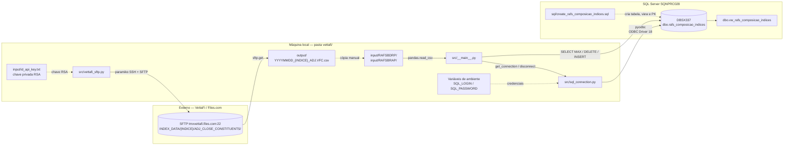
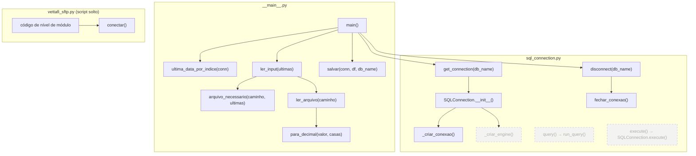
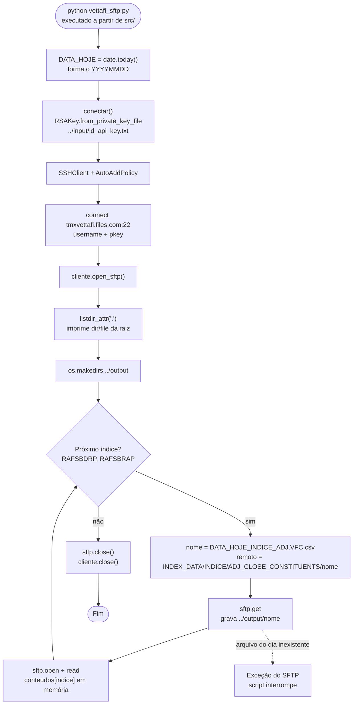
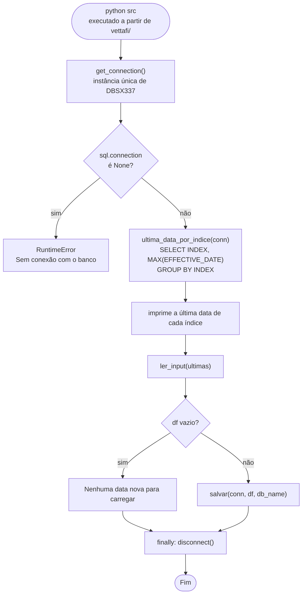
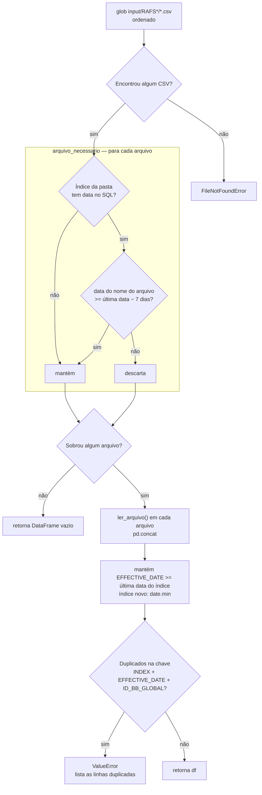
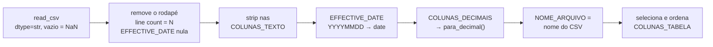
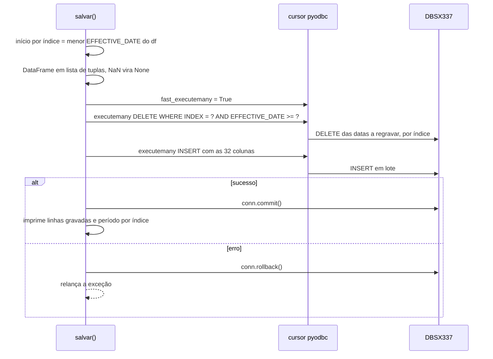
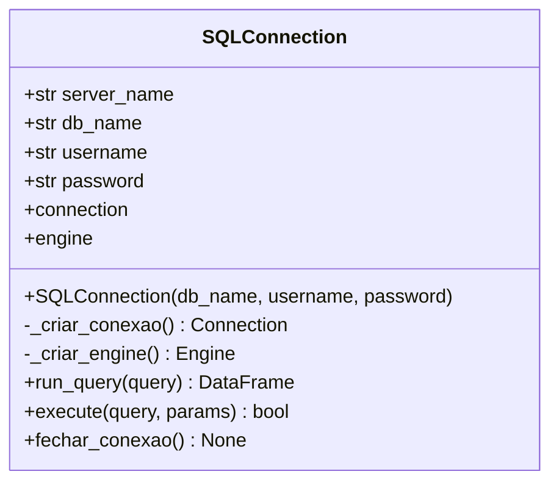
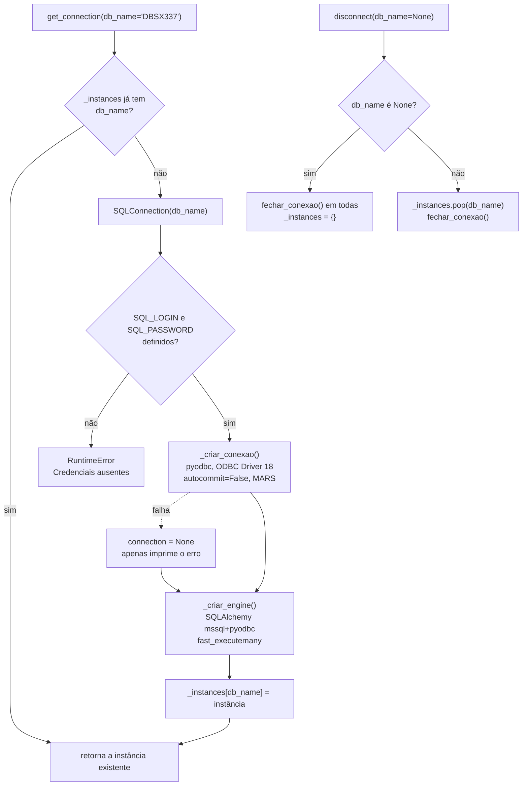
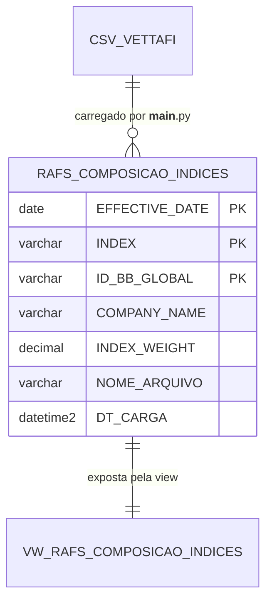

# VettaFi — Documentação

Pipeline da composição diária dos índices VettaFi **RAFSBDRP** e **RAFSBRAP**:

1. **Download** dos CSVs diários no SFTP da VettaFi (Files.com) — `src/vettafi_sftp.py`
2. **Carga incremental** dos CSVs no SQL Server `SQNPRC028 / DBSX337.dbo.rafs_composicao_indices` — `src/__main__.py`
3. **Conexão** com o SQL Server (pyodbc + SQLAlchemy, singleton por banco) — `src/sql_connection.py`

---

## Sumário

1. [Visão geral](#1-visão-geral)
2. [Arquitetura e conexões](#2-arquitetura-e-conexões)
3. [Mapa de chamadas entre módulos](#3-mapa-de-chamadas-entre-módulos)
4. [vettafi_sftp.py](#4-vettafi_sftppy)
5. [\_\_main\_\_.py](#5-__main__py)
6. [sql_connection.py](#6-sql_connectionpy)
7. [Modelo de dados](#7-modelo-de-dados)
8. [Como executar](#8-como-executar)
9. [Pontos de atenção](#9-pontos-de-atenção)

---

## 1. Visão geral

| Arquivo | Papel |
|---|---|
| `src/vettafi_sftp.py` | Conecta no SFTP da VettaFi com chave RSA e baixa o CSV do dia de cada índice para `output/`. |
| `src/__main__.py` | Lê os CSVs de `input/RAFS*/`, trata os tipos e grava de forma incremental na tabela SQL. |
| `src/sql_connection.py` | Camada de acesso ao SQL Server: classe `SQLConnection` e funções globais com uma instância única por banco. |
| `sql/create_rafs_composicao_indices.sql` | DDL (referência) da tabela `dbo.rafs_composicao_indices` e da view `dbo.vw_rafs_composicao_indices`. |

Estrutura de pastas relevante:

```
vettafi/
├── doc.md
├── input/
│   ├── id_api_key.txt              # chave privada RSA do SFTP
│   ├── RAFSBDRP/                   # CSVs lidos pela carga (nome da pasta = valor da coluna INDEX)
│   │   └── YYYYMMDD_RAFSBDRP_ADJ.VFC.csv
│   └── RAFSBRAP/
│       └── YYYYMMDD_RAFSBRAP_ADJ.VFC.csv
├── output/                         # destino do download SFTP
│   └── YYYYMMDD_<INDICE>_ADJ.VFC.csv
├── sql/
│   └── create_rafs_composicao_indices.sql
└── src/
    ├── __main__.py
    ├── sql_connection.py
    └── vettafi_sftp.py
```

---

## 2. Arquitetura e conexões



Resumo das conexões:

| Origem | Destino | Tecnologia | Autenticação |
|---|---|---|---|
| `vettafi_sftp.py` | `tmxvettafi.files.com:22` | `paramiko` (SSH/SFTP) | Usuário Files.com + chave RSA em `input/id_api_key.txt` |
| `sql_connection.py` | `SQNPRC028 / DBSX337` | `pyodbc` (ODBC Driver 18 for SQL Server) | `SQL_LOGIN` / `SQL_PASSWORD` (variáveis de ambiente) |
| `sql_connection.py` | `SQNPRC028 / DBSX337` | SQLAlchemy `mssql+pyodbc` | Idem (engine criado, mas não usado pela carga) |

> A passagem de `output/` para `input/RAFS<INDICE>/` **não é automatizada** no código atual (ver [Pontos de atenção](#9-pontos-de-atenção)).

---

## 3. Mapa de chamadas entre módulos



- Linhas tracejadas = funções disponíveis em `sql_connection.py` que **não** são usadas pela carga (`query`, `execute`, engine SQLAlchemy).
- `vettafi_sftp.py` não é importado por nenhum outro módulo; roda de forma independente.

---

## 4. `vettafi_sftp.py`

Script que baixa, via SFTP, o arquivo do dia de cada índice. **Todo o código roda no import** (não há `if __name__ == "__main__"`), e os caminhos são relativos ao diretório de trabalho — por isso deve ser executado a partir de `src/`.

### Constantes

| Constante | Valor | Descrição |
|---|---|---|
| `HOST` | `tmxvettafi.files.com` | Servidor SFTP da VettaFi (Files.com) |
| `PORT` | `22` | Porta SSH |
| `USERNAME` | usuário da conta Files.com | Configurações > Usuários > Nome de usuário |
| `KEY_PATH` | `../input/id_api_key.txt` | Chave privada RSA |
| `PASSPHRASE` | `None` | Senha da chave privada, se houver |
| `OUTPUT_DIR` | `../output` | Destino dos downloads |
| `DATA_HOJE` | `date.today()` em `YYYYMMDD` | Data usada no nome do arquivo remoto |
| `INDICES` | `["RAFSBDRP", "RAFSBRAP"]` | Índices baixados |

### Funções

| Função | Retorno | Descrição |
|---|---|---|
| `conectar()` | `paramiko.SSHClient` | Carrega a chave RSA, cria o cliente SSH com `AutoAddPolicy` (aceita a chave do host no 1º acesso) e conecta em `HOST:PORT`. |

### Caminho remoto

```
INDEX_DATA/{INDICE}/ADJ_CLOSE_CONSTITUENTS/{DATA_HOJE}_{INDICE}_ADJ.VFC.csv
```

### Fluxograma



---

## 5. `__main__.py`

Carrega a composição diária dos índices (`input/RAFS*/*.csv`) na tabela `DBSX337.dbo.rafs_composicao_indices`.

**Carga incremental por índice:** busca no SQL a última `EFFECTIVE_DATE` gravada de cada índice e regrava a partir dela (inclusive), apagando e reinserindo essas datas na mesma transação. Índice ainda sem dados no SQL é carregado desde o primeiro arquivo.

### Constantes

| Constante | Valor | Descrição |
|---|---|---|
| `BASE_DIR` | pasta `vettafi/` | Resolvido a partir de `__file__` (independe do diretório de trabalho) |
| `INPUT_DIR` | `vettafi/input` | Origem dos CSVs |
| `TABELA` | `dbo.rafs_composicao_indices` | Tabela de destino |
| `CONTEXTO_DECIMAL` | `Context(prec=38)` | Precisão máxima do `DECIMAL` no SQL Server |
| `MARGEM_DATA_ARQUIVO` | 7 dias | Margem para selecionar arquivos (o nome do arquivo tem a data do pregão **anterior** à `EFFECTIVE_DATE`; a margem cobre feriados) |
| `COLUNAS_TEXTO` | 16 colunas | Colunas de texto (recebem `strip`) |
| `COLUNAS_DECIMAIS` | 14 colunas → casas | Colunas numéricas e nº de casas decimais, iguais ao `DECIMAL(p,s)` da tabela |
| `COLUNAS_TABELA` | 32 colunas | Ordem das colunas no `INSERT` (`DT_CARGA` é preenchida pelo default do SQL) |

### Funções

| Função | Entrada | Saída | Descrição |
|---|---|---|---|
| `main()` | — | — | Orquestra: conexão → últimas datas → leitura → gravação → desconexão (em `finally`). |
| `ultima_data_por_indice(conn)` | conexão pyodbc | `Dict[str, date]` | `SELECT [INDEX], MAX(EFFECTIVE_DATE) ... GROUP BY [INDEX]`. |
| `ler_input(ultimas)` | últimas datas | `DataFrame` | Seleciona os arquivos necessários, lê, filtra datas já gravadas e valida duplicidade na chave. |
| `arquivo_necessario(caminho, ultimas)` | caminho do CSV, últimas datas | `bool` | Usa o **nome da pasta** como índice. Sem data no SQL → `True`; senão, `data_do_nome >= ultima - 7 dias`. |
| `ler_arquivo(caminho)` | caminho do CSV | `DataFrame` | Lê como texto, remove o rodapé, faz `strip`, converte data e decimais e adiciona `NOME_ARQUIVO`. |
| `para_decimal(valor, casas)` | texto, nº de casas | `Decimal` ou `None` | Vazio/NaN → `None`; senão `Decimal(valor).quantize(10^-casas)` com precisão 38. |
| `salvar(conn, df, db_name)` | conexão, DataFrame, nome do banco | — | `DELETE` por índice a partir da menor data + `INSERT` em lote na mesma transação; `rollback` em caso de erro. |

### Fluxograma — `main()`



### Fluxograma — `ler_input()` e `arquivo_necessario()`



### Fluxograma — `ler_arquivo()`



### Sequência — `salvar()`



### Exemplo de carga incremental

Última data no SQL para `RAFSBDRP` = `2026-09-24`:

1. `arquivo_necessario` mantém os arquivos com data no nome `>= 2026-09-17` (24/09 − 7 dias).
2. `ler_input` descarta as linhas com `EFFECTIVE_DATE < 2026-09-24`.
3. `salvar` apaga `RAFSBDRP` com `EFFECTIVE_DATE >= 2026-09-24` e reinsere as linhas lidas.

Com isso, reprocessar a mesma data é idempotente, e a última data é sempre regravada (cobre arquivos reenviados/corrigidos).

---

## 6. `sql_connection.py`

Camada de conexão com o SQL Server `SQNPRC028`. Mantém **uma instância de `SQLConnection` por banco** em `_instances`.

### Classe `SQLConnection`



| Membro | Descrição |
|---|---|
| `__init__(db_name="DBSX337", username=None, password=None)` | Servidor fixo `SQNPRC028`. Sem usuário/senha informados, lê `SQL_LOGIN` / `SQL_PASSWORD`; se faltarem, `RuntimeError`. Cria `connection` e `engine`. |
| `_criar_conexao()` | `pyodbc.connect` com ODBC Driver 18, `TrustServerCertificate=yes`, `Mars_Connection=Yes`, `autocommit=False`. Em falha, imprime o erro e retorna `None`. |
| `_criar_engine()` | Engine SQLAlchemy `mssql+pyodbc` com `fast_executemany=True`, para `pd.read_sql` / `to_sql`. Em falha, retorna `None`. |
| `run_query(query)` | `SELECT` → `DataFrame` (via engine). Em erro, retorna `DataFrame` vazio. |
| `execute(query, params=None)` | DML com `commit` a cada comando; `rollback` e `False` em erro. |
| `fechar_conexao()` | Fecha a conexão pyodbc. |

### Funções globais

| Função | Descrição |
|---|---|
| `get_connection(db_name="DBSX337")` | Retorna a instância existente do banco ou cria uma nova e guarda em `_instances`. |
| `query(sql_str, db_name)` | Atalho para `get_connection(db_name).run_query(sql_str)`. |
| `execute(sql_str, params, db_name)` | Atalho para `get_connection(db_name).execute(sql_str, params)`. |
| `disconnect(db_name=None)` | Fecha a conexão de um banco, ou de todos se `db_name` for `None`, e reseta o singleton. |

### Fluxograma — `get_connection()` / `disconnect()`



---

## 7. Modelo de dados

### Arquivo de entrada (CSV VettaFi)

- Nome: `YYYYMMDD_<INDICE>_ADJ.VFC.csv`. A data do nome é o pregão **anterior** à `EFFECTIVE_DATE` do conteúdo (ex.: `20260923_RAFSBDRP_ADJ.VFC.csv` contém `EFFECTIVE_DATE = 20260924`).
- Cabeçalho com 31 colunas (as mesmas da tabela, sem `NOME_ARQUIVO` e `DT_CARGA`).
- Última linha é um rodapé `line count = N`, descartado na leitura.
- Campos de texto podem ter espaços sobrando (ex.: `COUNTRY = "US "`), removidos com `strip`.
- `EFFECTIVE_DATE` no formato `YYYYMMDD`.

### Tabela `DBSX337.dbo.rafs_composicao_indices`

Chave primária: `PK_rafs_composicao_indices` = `(EFFECTIVE_DATE, [INDEX], ID_BB_GLOBAL)` — a mesma chave usada na checagem de duplicidade de `ler_input`.

| Coluna | Tipo SQL | Nulo | Origem |
|---|---|---|---|
| `[INDEX]` | `VARCHAR(20)` | não | CSV |
| `EFFECTIVE_DATE` | `DATE` | não | CSV (`YYYYMMDD` → `date`) |
| `COMPANY_NAME` | `VARCHAR(200)` | sim | CSV |
| `BB_TICKER` | `VARCHAR(30)` | sim | CSV |
| `SEDOL` | `VARCHAR(10)` | sim | CSV |
| `CUSIP` | `VARCHAR(12)` | sim | CSV |
| `ISIN` | `VARCHAR(12)` | sim | CSV |
| `ID_BB_GLOBAL` | `VARCHAR(12)` | não | CSV |
| `ICE_SECTOR_CODE` | `VARCHAR(20)` | sim | CSV |
| `ICE_SECTOR_NAME` | `VARCHAR(100)` | sim | CSV |
| `VETTAFI_CATEGORY` | `VARCHAR(100)` | sim | CSV |
| `MIC` | `VARCHAR(10)` | sim | CSV |
| `COUNTRY` | `VARCHAR(5)` | sim | CSV |
| `REGION` | `VARCHAR(50)` | sim | CSV |
| `SIZE` | `VARCHAR(50)` | sim | CSV |
| `CAP` | `VARCHAR(50)` | sim | CSV |
| `CURR` | `VARCHAR(3)` | sim | CSV |
| `LOCAL_PRICE` | `DECIMAL(28,8)` | sim | CSV |
| `FX_RATE` | `DECIMAL(28,16)` | sim | CSV |
| `INDEX_PRICE` | `DECIMAL(28,16)` | sim | CSV |
| `SHARES_OUTSTANDING` | `DECIMAL(38,4)` | sim | CSV |
| `MARKET_CAP` | `DECIMAL(38,16)` | sim | CSV |
| `[FLOAT]` | `DECIMAL(28,16)` | sim | CSV |
| `WAF` | `DECIMAL(28,16)` | sim | CSV |
| `INDEX_SHARES` | `DECIMAL(38,16)` | sim | CSV |
| `INDEX_MARKET_CAP` | `DECIMAL(38,16)` | sim | CSV |
| `INDEX_WEIGHT` | `DECIMAL(28,16)` | sim | CSV |
| `DAILY_PRICE_RETURN` | `DECIMAL(28,16)` | sim | CSV |
| `DAILY_TOTAL_RETURN` | `DECIMAL(28,16)` | sim | CSV |
| `DIVIDEND` | `DECIMAL(28,8)` | sim | CSV |
| `NET_DIVIDEND` | `DECIMAL(28,8)` | sim | CSV |
| `NOME_ARQUIVO` | `VARCHAR(100)` | sim | Preenchida pela carga (nome do CSV) |
| `DT_CARGA` | `DATETIME2(0)` | não | Default `SYSDATETIME()` no SQL |

> As casas decimais em `COLUNAS_DECIMAIS` (`__main__.py`) precisam acompanhar a escala do `DECIMAL(p,s)` da tabela. Se o DDL mudar, atualize o dicionário.

A view `dbo.vw_rafs_composicao_indices` expõe todas as colunas da tabela.



---

## 8. Como executar

### Dependências

- Python 3.12
- Pacotes: `paramiko`, `pandas`, `pyodbc`, `sqlalchemy`
- **ODBC Driver 18 for SQL Server** instalado
- Acesso de rede ao `tmxvettafi.files.com:22` e ao `SQNPRC028`

### 1) Download SFTP

```powershell
cd vettafi\src
python vettafi_sftp.py
```

Os arquivos do dia vão para `vettafi/output/`. Copie-os para a pasta do índice correspondente em `vettafi/input/RAFS<INDICE>/`.

### 2) Carga no SQL Server

```powershell
$env:SQL_LOGIN = "<usuario>"
$env:SQL_PASSWORD = "<senha>"
cd vettafi
python src
```

Saída esperada:

```
[OK] Conexão (pyodbc) com DBSX337 realizada com sucesso!
[OK] Engine (SQLAlchemy) para DBSX337 criado com sucesso!
Última data no SQL - RAFSBDRP: 2026-09-24
Última data no SQL - RAFSBRAP: 2026-09-24
Lendo N arquivos de ...\vettafi\input
X linhas gravadas em DBSX337.dbo.rafs_composicao_indices:
  RAFSBDRP: 2026-09-24 a 2026-09-24 (1 datas)
  RAFSBRAP: 2026-09-24 a 2026-09-24 (1 datas)
[FECHADO] Conexão pyodbc fechada.
```

---

## 9. Pontos de atenção

| # | Módulo | Ponto |
|---|---|---|
| 1 | fluxo | O download grava em `output/` e a carga lê de `input/RAFS<INDICE>/`; a cópia entre as pastas é manual. |
| 2 | `vettafi_sftp.py` | Usa `date.today()` no nome do arquivo. Como o nome traz a data do pregão anterior à `EFFECTIVE_DATE`, o arquivo de hoje pode ainda não existir (fim de semana, feriado ou horário de publicação), e o `sftp.get` levanta exceção. |
| 3 | `vettafi_sftp.py` | Roda no import e usa caminhos relativos (`../input`, `../output`): só funciona com o diretório de trabalho em `src/`. Não há `try/finally` para fechar a conexão em caso de erro. |
| 4 | `vettafi_sftp.py` | Cada arquivo é transferido duas vezes (`sftp.get` + `sftp.open().read()`); o dicionário `conteudos` não é usado depois. |
| 5 | `vettafi_sftp.py` | `AutoAddPolicy` aceita qualquer chave de host, sem validar a identidade do servidor. |
| 6 | repositório | `input/id_api_key.txt` (chave privada do SFTP) está versionado no git. |
| 7 | `__main__.py` | O nome da pasta em `input/` precisa ser igual ao valor da coluna `INDEX` do CSV, pois `arquivo_necessario` usa a pasta para buscar a última data. |
| 8 | `sql_connection.py` | Falha no `pyodbc.connect` não levanta exceção (retorna `None`); a checagem fica a cargo de `main()`. O engine SQLAlchemy é criado mas não é usado pela carga, e `disconnect()` não chama `engine.dispose()`. |
